# 🚀 LEARN abC

> A progressive C programming learning journey — from pointer fundamentals to custom memory allocators, binary file formats, and terminal-based games.

[](https://en.cppreference.com/w/c)
[](https://cmake.org)
[](https://github.com)
[](https://en.wikipedia.org/wiki/Data_structure)
[](https://en.wikipedia.org/wiki/Memory_management)
[](https://en.wikipedia.org/wiki/Serialization)
[](LICENSE)

---

## ✨ Features

| Feature | Description |
|---------|-------------|
| 🎯 **Progressive Exercises** | 40+ C files covering fundamentals (pointers, bit manipulation) through advanced topics (custom allocators, binary formats) |
| 🧠 **Custom Memory Arena** | Bump-pointer allocator (`Arena`) with allocation stats, alignment tracking, and zero-overhead resets |
| 💾 **Binary File Format** | Full serialization engine with CRC32 checksums, index tables, and a custom `MLDB` file format |
| 🔗 **Generic Linked List** | Doubly-linked list with function-pointer callbacks for `forEach`, `filter`, `any`, `every` |
| 📦 **Dynamic Array Library** | Type-generic dynamic arrays (`SALOK`) with leak tracking and filename/line recording |
| 🎮 **Terminal Games** | Battleship (cross-platform raw terminal UI) and BlackJack with colored output |
| 📚 **SOCS Coursework** | BINUS SOCS lab solutions with progressive difficulty |
| 🔧 **CMake Build** | Modern CMake 3.20+ build system with C11 standard enforcement |

---

## 🏗️ Architecture

```mermaid
graph TD
    subgraph Root Exercises
        A[first.c<br/>Pointers & IO] --> B[decimalBinary.c<br/>Bit Manipulation]
        B --> C[bitFields.c<br/>Struct Bitfields]
        C --> D[LW01IO.c<br/>File I/O]
        E[printMem.c<br/>Memory Layout] --> F[pointerConfusion.c<br/>Pointer Arithmetic]
        F --> G[HeapTree.c<br/>Heap Data Structure]
    end

    subgraph SALOK Dynamic Array
        H[SALOK_V1.c/h<br/>Type-Safe DA] --> I[SALOK_V2.c/h<br/>Heap-Tracked DA]
        I --> J[callocc Macro<br/>Filename + Line Tracking]
    end

    subgraph TrackVault Engine
        K[arena.c/h<br/>Bump Allocator] --> L[library.c/h<br/>Track Collection]
        M[serialization.c/h<br/>Binary Format] --> L
        N[bytes.c/h<br/>LE Encoding] --> M
        O[flags.c/h<br/>Bit Packing] --> M
        P[index.c/h<br/>ID Lookup] --> L
        Q[record.c/h<br/>Field Metadata] --> M
    end

    subgraph NAR Games & DS
        R[BattleShip.c<br/>Terminal UI] --> S[SALOK_V1.h<br/>Dynamic Arrays]
        T[LinkedList.c/h<br/>Generic List] --> U[BlackJack.c]
        V[TheGaje.c<br/>Game Dev] --> S
    end

    subgraph SOCS Coursework
        W[socs210926.c] --> X[socs280926.c]
        X --> Y[socs051026.c]
    end
```



---

## ⚡ Quick Start

### Prerequisites

- **C Compiler:** GCC 9+ or Clang 10+ (C11 support required)
- **CMake:** 3.20 or higher
- **OS:** Linux / macOS (Battleship game uses POSIX `termios`)

### Build

```bash
git clone https://github.com/yourusername/LEARN-abC.git
cd LEARN-abC
cmake -B cmake-build-debug -DCMAKE_BUILD_TYPE=Debug
cmake --build cmake-build-debug
```

### Run

```bash
./cmake-build-debug/LEARN_abC
```

### Run Individual Exercises

```bash
# Compile any standalone exercise directly
gcc -std=c11 -Wall -Wextra -o exercise first.c
./example

# Link with math library if needed
gcc -std=c11 -o decimalBinary decimalBinary.c -lm
```

---

## 📁 Project Structure

```
LEARN-abC/
├── 📂 Root Exercises
│   ├── first.c              # Pointers, sizeof, bubble sort, strtol
│   ├── LW01IO.c             # File I/O fundamentals
│   ├── decimalBinary.c      # Decimal ↔ Binary conversion
│   ├── bitFields.c          # Struct bitfield manipulation
│   ├── printMem.c           # Memory layout printing
│   ├── pointerConfusion.c   # Pointer arithmetic practice
│   ├── memoryContinuation.c # Memory contiguity
│   ├── damage.c             # Damage calculation formula
│   ├── psuedobullshit.c     # Experimental concepts
│   ├── module01.c           # Module 1 coursework
│   └── helper.h             # Shared helper functions
│
├── 📂 SALOK (Dynamic Array Library)
│   ├── SALOK_V1.c/h         # V1: Type-safe dynamic array with DA_DEFINE macro
│   └── SALOK_V2.c/h         # V2: Heap-tracked arrays with callocc macro
│
├── 📂 SOCS (BINUS Coursework)
│   ├── binusSOCS.c          # Coursework entry point
│   ├── socs210926.c         # Lab session 21 Sep 2026
│   ├── socs280926.c         # Lab session 28 Sep 2026
│   └── socs051026.c         # Lab session 05 Oct 2026
│
├── 📂 TrackVault (Music Library Engine)
│   ├── arena.c/h            # Bump-pointer allocator with stats
│   ├── library.c/h          # Track collection management
│   ├── serialization.c/h    # Binary file format (MLDB)
│   ├── bytes.c/h            # Little-endian encoding/decoding
│   ├── flags.c/h            # Bit-packed flag operations
│   ├── index.c/h            # ID-based track lookup
│   ├── record.c/h           # Field metadata reflection
│   ├── format.c/h           # Formatting utilities
│   ├── write.c              # File write operations
│   ├── shiftbits.c          # Bit shifting utilities
│   └── tests.c              # Test suite (in progress)
│
├── 📂 NAR (Games & Data Structures)
│   ├── BattleShip.c         # Terminal-based Battleship game
│   ├── BlackJack.c          # Blackjack card game
│   ├── LinkedList.c/h       # Generic doubly-linked list
│   ├── EasyJyToDo.c         # To-do list application
│   ├── TheGaje.c            # Game project
│   └── OJNAR12102026.c      # Online judge submission
│
├── 📂 BlackJack-NAR14102026-T229/
│   └── Archived submission files
│
├── 📂 NAR/zipzz/
│   └── Zipped submission archives
│
├── CMakeLists.txt           # Build configuration
└── README.md                # This file
```

---

## 🛠️ Tech Stack

| Component | Technology |
|-----------|------------|
| **Language** | C11 (C11 standard, no extensions) |
| **Build System** | CMake 3.20+ |
| **Compiler** | GCC / Clang |
| **Memory Management** | Custom Arena Allocator, Dynamic Arrays |
| **File I/O** | Binary serialization with CRC32 |
| **Terminal UI** | POSIX termios / Windows conio |
| **Data Structures** | Linked Lists, Dynamic Arrays, Heaps |
| **Games** | Battleship, BlackJack |

---

## 🧠 CS Topics Covered

| Concept | Where It's Used |
|---------|-----------------|
| **Arena / Bump Allocators** | `TrackVault/arena.c` — Custom allocator with alignment stats, `alloc_count`, `requested_bytes` tracking |
| **Binary Serialization** | `TrackVault/serialization.c` — Custom `MLDB` file format with header, index table, string pool, and footer |
| **CRC32 Checksums** | `TrackVault/serialization.h` — File integrity verification in footer |
| **Bit Manipulation** | `decimalBinary.c`, `TrackVault/flags.c` — Bit packing, shifting, masking |
| **Function Pointers** | `NAR/LinkedList.h` — `CompareFn`, `ForEachFn`, `PredicateFn` for generic list operations |
| **Terminal I/O (termios)** | `NAR/BattleShip.c` — Raw mode, cross-platform key detection |
| **Dynamic Arrays (Macros)** | `SALOK_V1.h`, `SALOK_V2.h` — `DA_DEFINE` macro for type-safe generic arrays |
| **Memory Layout** | `printMem.c`, `first.c` — Visualizing struct padding, array contiguity |
| **Doubly-Linked Lists** | `NAR/LinkedList.c` — Generic with `insertAt`, `removeAt`, `sort`, `reverse`, `filter` |
| **Heap Data Structures** | `HeapTree.c` — Heap tree implementation |
| **File Formats** | `TrackVault/library.h` — Documented byte-level layout with magic numbers, version fields |
| **Type Erasure (void\*)** | `SALOK_V2.h`, `NAR/LinkedList.h` — Generic programming patterns in C |
| **Cross-Platform Code** | `NAR/BattleShip.c` — Conditional compilation for Windows/POSIX |

---

## 📖 Key Highlights

### SALOK Dynamic Array (V2)
The most advanced component — a type-generic dynamic array system using C11 `_Generic`-like macros:

```c
DA_DEFINE(IntArray, int)    // Creates an int-specific dynamic array
DA_DEFINE(StrArray, char*)  // Creates a string dynamic array
```

Every allocation is tracked with filename and line number for leak detection.

### TrackVault Binary Format
The `MLDB` (Music Library Database) format is fully documented in `TrackVault/library.h`:

| Section | Size | Description |
|---------|------|-------------|
| **Header** | 20 bytes | Magic `MLDB`, version, count, offsets |
| **Record Table** | 24 × count bytes | ID, flags, rating, duration, year, title/artist offsets |
| **String Pool** | Variable | UTF-8 title + artist bytes |
| **Footer** | 8 bytes | CRC32 checksum + `ENDM` marker |

### BattleShip Game
A full terminal-based Battleship with:
- Cross-platform raw input (Windows `_getch` / POSIX `termios`)
- Menu system with keybinding navigation
- Colored board rendering with ASCII borders
- Ship placement with rotation

---

## 📝 License

This is a personal learning repository. No license is specified yet.

---

<div align="center">

**Built with 💙 and lots of `segfault`s using C11**

[Report Bug](https://github.com/yourusername/LEARN-abC/issues) · [Request Feature](https://github.com/yourusername/LEARN-abC/issues)

</div>
